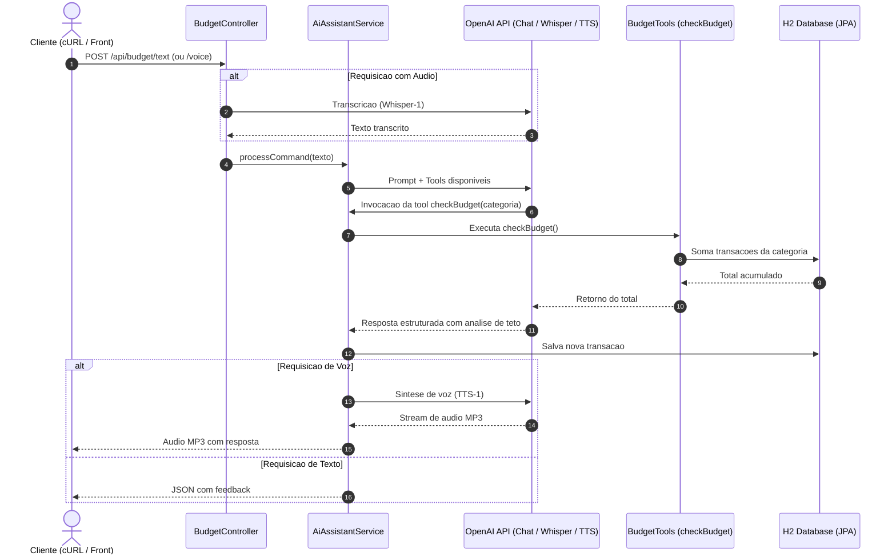

# Budget API - Controle Financeiro com Spring AI

API RESTful desenvolvida com Spring Boot 3 e Spring AI para gestão orçamentária e categorização financeira inteligente através de processamento de linguagem natural. A aplicação aceita comandos em texto ou mensagens de áudio, utilizando modelos generativos da OpenAI para transcrever, extrair entidades financeiras e registrar despesas. Por meio de *Tool Calling* (Function Calling), a inteligência artificial consulta dinamicamente o banco de dados em tempo de execução para verificar o teto de gastos da categoria e fornecer respostas orientadas a controle financeiro.

---

## Funcionalidades

- **Entrada Multimodal:** Processamento de despesas via texto livre em JSON ou arquivos de áudio (`.mp3`, `.m4a`, `.wav`) com transcrição via Whisper.
- **Tool Calling (Function Calling):** Invocação dinâmica da função interna Java (`checkBudget`) pelo modelo de IA para calcular o acumulado de gastos na categoria antes de persistir o registro.
- **Categorização Automatizada:** Identificação contextual da categoria da despesa e extração de valores sem necessidade de seleção manual em formulários.
- **Alertas de Orçamento:** Avaliação em tempo real com base no limite financeiro configurado, gerando feedback de alerta ou confirmação tanto em texto quanto em áudio sintetizado (TTS).
- **Persistência em Memória:** Armazenamento relacional com Spring Data JPA e H2 Database.
- **Documentação OpenAPI / Swagger:** Interface Swagger UI integrada para testes e inspeção de contratos.

---

## Arquitetura da Solução



---

## Tecnologias

- **Linguagem:** Java 17
- **Framework:** Spring Boot 3.3.3
- **Integração com IA:** Spring AI 1.0.0-M2 (OpenAI Starter)
- **Modelos de IA:**
  - `gpt-4o` / `gpt-3.5-turbo`: Interpretação semântica e Tool Calling
  - `whisper-1`: Transcrição de áudio para texto
  - `tts-1`: Síntese de fala a partir da resposta gerada
- **Persistência:** Spring Data JPA e H2 Database (banco embutido)
- **Documentação de API:** SpringDoc OpenAPI 2.6.0 (Swagger UI)

---

## Como Executar

### Pré-requisitos
- JDK 17 ou superior instalado.
- Chave de API da OpenAI (`OPENAI_API_KEY`).

### 1. Definir a Chave da OpenAI

No Linux/macOS:
```bash
export OPENAI_API_KEY="sk-..."
```

No Windows (PowerShell):
```powershell
$env:OPENAI_API_KEY="sk-..."
```

### 2. Inicializar a Aplicação

Via Maven Wrapper:

```bash
# Linux/macOS:
./mvnw spring-boot:run

# Windows (PowerShell):
.\mvnw.cmd spring-boot:run
```

A API estará acessível em `http://localhost:8080`.

---

## Documentação e Consoles

- **Swagger UI:** [http://localhost:8080/swagger-ui.html](http://localhost:8080/swagger-ui.html)
- **H2 Console:** [http://localhost:8080/h2-console](http://localhost:8080/h2-console)
  - **JDBC URL:** `jdbc:h2:mem:budgetdb`
  - **User:** `sa`
  - **Password:** `password`

---

## Exemplos de Uso

### 1. Registro de Despesa por Texto

```bash
curl -X POST http://localhost:8080/api/budget/text \
  -H "Content-Type: application/json" \
  -d '{"message": "Gastei 150 reais no supermercado hoje comprando suprimentos da semana."}'
```

**Exemplo de Resposta:**
```json
{
  "reply": "Despesa de R$ 150,00 na categoria Alimentação registrada com sucesso. Seu gasto acumulado nesta categoria está dentro do orçamento."
}
```

### 2. Registro de Despesa por Áudio

Envie um arquivo de áudio com o relato da despesa:

```bash
curl -X POST http://localhost:8080/api/budget/voice \
  -F "audio=@/caminho/para/audio_gasto.mp3" \
  --output resposta.mp3
```
O servidor retornará o arquivo `resposta.mp3` com a resposta sintetizada em áudio pela IA.